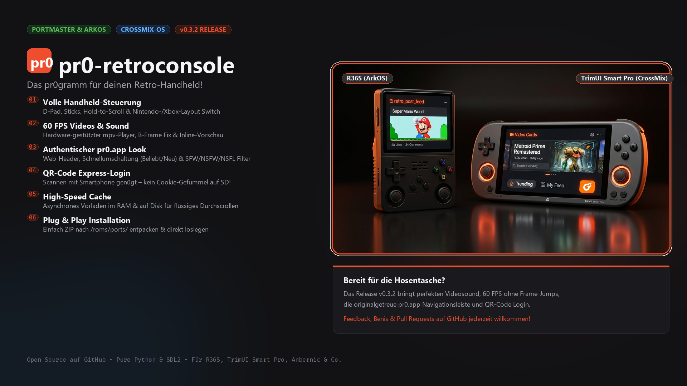

# pr0-retroconsole



> Ein nativer Handheld-Client für das Imageboard **pr0.app** (pr0gramm) auf Basis von Python und Pygame (SDL2), optimiert für Linux-basierte Retro-Gaming-Handhelds wie den **R36S** (640x480, ArkOS) und den **TrimUI Smart Pro** (1280x720, CrossMix OS).

Basierend auf den bewährten Architekturmustern von [ha-retroconsole](https://github.com/slickor/ha-retroconsole).

---

## Features

- **Performance auf Low-End-Hardware:** Vollständig asynchrones Multithreading für Image-Downloads und API-Calls ohne Ruckler oder Frame-Drops im Main-Render-Thread.
- **Dynamische Skalierung:** Unterstützt native 640x480 (4:3, R36S) und 1280x720 (16:9, TrimUI Smart Pro) mit automatischer UI- und Thumbnail-Grid-Anpassung.
- **pr0-Farbschema:** Originalgetreues Styling (`#161618` Richtiges Grau, `#212124` Cards/Overlays, `#ee4d2e` pr0-Orange).
- **Intelligente Ansichten:**
  - **Grid-View:** Flüssiges Raster aus Thumbnails mit `[VID]`-Indikatoren, Endlos-Scrollen (`older`-Pagination) und Header mit aktuellem Feed-Modus.
  - **Post-View:** Vollbildanzeige. Bei "Tapeten" (Bilder mit Seitenverhältnis $height / width > 1.5$) automatischer Wechsel auf "Fit-to-Width" mit vertikalem Scrollen.
  - **Info- & Kommentar-Overlay:** Einblendbare Seitenleiste mit hierarchisch eingerücktem Kommentarbaum, Upvote/Downvote-Benis-Scores und Top-Tags.
- **Plattformübergreifendes Video-Handling:**
  - Startet `mpv` mit Hardware-Decoding auf ARM-Handhelds im Vollbildmodus.
  - Fenstermodus für Desktop-Testing auf Windows / macOS.
  - Fallback-Badge `[VIDEO - mpv nicht gefunden]`, falls kein Player installiert ist.
  - SDL2-Event-Pufferung verhindert unbeabsichtigtes Schließen nach dem Videobeenden.
- **RAM-Disk Caching:** Asynchroner Download nach `/tmp/pr0cache` (tmpfs auf Handhelds) mit automatischem Cache-Cleanup (max. 100 Dateien).
- **Controller & Keyboard Dual-Input:** Unterstützt native SDL2-Gamepad-Events sowie Tastatur-Fallbacks für lokales Testen und `gptokeyb`.

---

## Steuerung & Tastenbelegung

| Handheld Button | PC / Tastatur | Funktion in Grid-View | Funktion in Post-View (inkl. Kommentare) |
|---|---|---|---|
| **D-Pad Links / Rechts** | `Pfeiltasten ◄ / ►` | Navigation im Thumbnail-Raster | Vorheriger / Nächster Post |
| **D-Pad Oben / Unten** | `Pfeiltasten ▲ / ▼` | Vertikale Zeilennavigation | Durch Bild/Video, Tags & Kommentare scrollen |
| **Rechter Stick** | `W` / `S` (oder `PgUp`/`PgDn`) | Schnelles vertikales Scrollen | Schnelles Scrollen im Post & Kommentarbaum |
| **A** | `Enter` / `Leertaste` | Post öffnen | Video im Vollbild abspielen (mpv) |
| **B** | `Esc` / `Backspace` / `Q` | App beenden (2x drücken) | Zurück zum Grid |
| **X** | `I` / `X` | Einstellungen & Farbschema öffnen | Einstellungen öffnen |
| **Y** | `Tab` / `Y` | Wechsel zwischen *Beliebt* & *Neu* | - |
| **R1** | `+` / `=` | Content-Filter wechseln (SFW, NSFW, etc.) | Upvote (+1 Blussi) vergeben |
| **L1** | `-` | Content-Filter wechseln | Downvote (-1) vergeben |

---

## Projektstruktur

```text
pr0-retroconsole/
├── assets/
│   └── fonts/                     # Bundled TrueType Fonts (Inter, FiraCode, m5x7)
├── src/
│   ├── main.py                    # Entry Point, Main Loop & State Machine
│   ├── api.py                     # pr0.app REST Client & Nonce-Extraction
│   ├── cache.py                   # Asynchroner RAM-Disk/Disk Downloader & Surface-Cache
│   ├── ui.py                      # Skalierendes Pygame UI Rendering (Grid, Post, Overlay)
│   ├── input.py                   # SDL2 Gamepad- & Keyboard-Input Dispatcher
│   └── video.py                   # Plattformübergreifender mpv/ffplay Video-Launcher
├── config.example.json            # Vorlage für Einstellungen & me-Cookie Auth
├── pr0.gptk                       # gptokeyb Mapping für Handheld-Hardware
├── pr0-retroconsole.sh            # PortMaster / EmulationStation Startskript
├── install.sh                     # Automatischer Offline/Online-Installer für Handhelds
├── requirements.txt               # pygame, requests, Pillow
└── README.md
```

---

## Installation & Einrichtung

### 1. Lokales Testen am PC (Windows, macOS, Linux)

1. Repository klonen und Abhängigkeiten installieren:
   ```bash
   pip install -r requirements.txt
   ```
2. Konfiguration erstellen:
   ```bash
   cp config.example.json config.json
   ```
3. App starten:
   ```bash
   python src/main.py
   ```

### 2. Handheld-Release erstellen (für R36S / ArkOS / PortMaster)

Führe einfach das PowerShell-Build-Skript aus:
```powershell
.\build.ps1
```
Das Skript erzeugt automatisch die Datei `pr0-retroconsole.zip` (~330 KB):
- Windows-`.exe`-Dateien (`bin/`) und `.bat`/`.ps1`-Skripte werden automatisch ausgeschlossen.
- Alle Shell-Skripte (`.sh`, `.gptk`) werden mit sauberen Unix-`LF`-Zeilenumbrüchen versehen.
- Das ZIP folgt der PortMaster-Struktur (`pr0-retroconsole.sh` an der Wurzel, daneben der Ordner `pr0-retroconsole/`).

### 3. Installation auf dem Handheld (ArkOS, CrossMix OS, PortMaster)

1. Entpacke den Inhalt von `pr0-retroconsole.zip` direkt in das `ports`-Verzeichnis auf der SD-Karte:
   - ArkOS / R36S: `/roms/ports/` (bzw. Laufwerk `EASYROMS:\ports\`)
   - CrossMix OS / TrimUI: `/mnt/SDCARD/Emus/PORTS/`
   -> Es liegt nun `pr0-retroconsole.sh` direkt in `ports/` und der Ordner `pr0-retroconsole/` daneben.
2. SD-Karte wieder in den Handheld stecken, im Menü **Ports** starten und loslegen!
   (Beim ersten Start führt `pr0-retroconsole.sh` automatisch `install.sh` aus, falls Abhängigkeiten fehlen).

---

## Konfiguration (`config.json`)

```json
{
  "resolution": "auto",
  "width": 640,
  "height": 480,
  "fullscreen": false,
  "promoted": 1,
  "flags": 1,
  "me_cookie": "",
  "cache_dir": "/tmp/pr0cache",
  "max_cache_files": 100,
  "fps": 30
}
```

### Flags-Bitmaske
- `1` = SFW (Standard)
- `2` = NSFW
- `4` = NSFL
- `8` = NSFP
- Kombinationen durch Addition: z. B. `3` für SFW + NSFW.

### Authentifizierung & Login
Für Upvotes/Downvotes sowie NSFW-/NSFL-Inhalte stehen drei bequeme Anmeldemethoden zur Verfügung:

1. **Smartphone-Companion (Empfohlen):**
   * Im Menü (`X`) auf **pr0gramm Account** drücken (`A`).
   * Den angezeigten QR-Code mit der Smartphone-Kamera scannen (Geräte müssen im selben WLAN sein).
   * Im Smartphone-Browser Benutzername, Passwort und Captcha eingeben – der Handheld loggt sich sofort automatisch ein!
2. **Direkt auf dem Handheld:**
   * Im Anmelde-Bildschirm `X` drücken, um auf direkte Eingabe umzuschalten.
   * Mit dem integrierten virtuellen On-Screen-Keyboard Zugangsdaten und Captcha eingeben.
3. **Manuell per `config.json`:**
   * Bestehenden `me`-Cookie-Wert aus dem Browser direkt in `config.json` unter `"me_cookie"` einfügen.

---

## Lizenz & Disclaimer

### Lizenz
Dieses Projekt ist unter der [MIT License](LICENSE) lizenziert.

### Disclaimer
Dies ist ein inoffizielles, freies Community-Projekt und steht in **keiner geschäftlichen oder offiziellen Verbindung** zu *pr0gramm* bzw. *pr0.app*. Alle Markennamen, Logos und abgerufenen Bild-/Videoinhalte sind Eigentum der jeweiligen Rechteinhaber bzw. Uploader. Dieses Tool dient lediglich als Schnittstelle zur Darstellung auf Retro-Gaming-Hardware.
