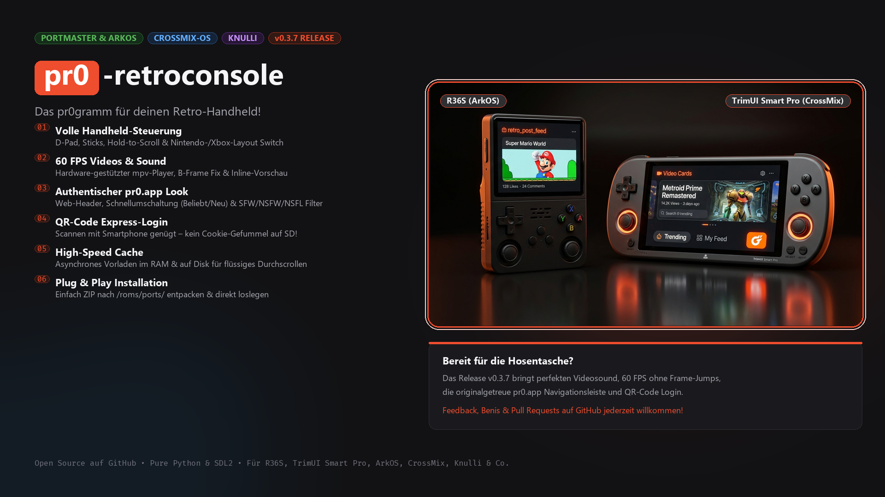
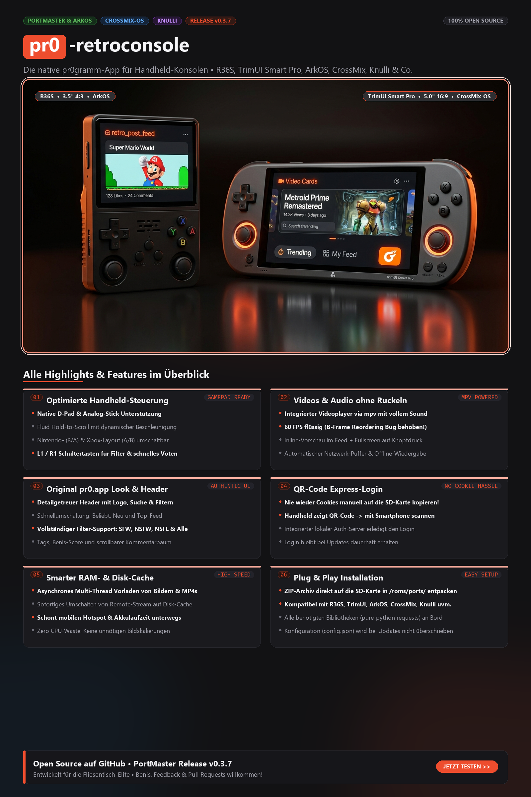

# pr0-retroconsole

<p align="center">
  
</p>

<p align="center">
  <a href="https://github.com/slickor/pr0-retroconsole/releases"></a>
  
  
  <a href="CHANGELOG.md"></a>
  <a href="LICENSE"></a>
</p>

> **pr0-retroconsole** ist ein nativer, leichtgewichtiger Client für das Imageboard [pr0gramm](https://pr0gramm.com), maßgeschneidert für Linux-basierte Retro-Handheld-Konsolen wie den **R36S** (640x480, ArkOS), den **TrimUI Smart Pro** (1280x720, CrossMix-OS), Anbernic-, Powkiddy-, Knulli- und PortMaster-Systeme.

---

<details>
<summary>📱 <b>Infografik & Feature-Poster ansehen (Klicken zum Ausklappen)</b></summary>
<br>
<p align="center">
  
</p>
</details>

---

## Highlights & Features

- **Flüssiger Videosound & 60 FPS:**
  - Videos laufen direkt in der Post-Vorschau synchron mit Ton.
  - Vollbild-Wiedergabe via `mpv` auf Knopfdruck (`A`) mit Pause/Unpause und sauberem Beenden (`B`).
  - Spezieller Software-Decoder-Modus (`--hwdec=no`) behebt den Allwinner-A133 DTS/PTS B-Frame-Ruckel-Bug auf dem TrimUI Smart Pro.
- **Originalgetreuer pr0.app Look:**
  - Authentischer Web-Header mit Suchleiste, Benis-Punkten, Benutzernamen und korrekten Rang-Farben (*Schwuchtel, Neuschwuchtel, Altschwuchtel, Moderator, Admin*).
  - Integrierter Farbschema- und Akzent-Wechsler in den Einstellungen (*pr0 Dark, OLED Schwarz, Nord, Gruvbox, Retro Terminal*).
- **Komfortable Handheld-Bedienung:**
  - Flüssiges D-Pad & Analog-Stick Scrolling mit dynamischer Beschleunigung.
  - Umschaltung zwischen **Beliebt** und **Neu** blitzschnell über `L2` / `R2` (oder `Y`).
  - Schneller Content-Filter-Wechsel (SFW, NSFW, NSFL, Alle) über `R1` / `L1`.
  - Wählbares Button-Layout (Nintendo `A`/`B` vs. Xbox `B`/`A`).
- **QR-Code Express-Login:**
  - Kein manuelles Kopieren von Cookies auf die SD-Karte mehr nötig!
  - Handheld zeigt einen QR-Code an -> mit dem Smartphone scannen -> im Browser einloggen -> Handheld ist sofort angemeldet.
  - Alternativ steht eine Bildschirmtastatur zur Direkteingabe bereit.
- **Vollständiger Kommentarbaum:**
  - Hierarchische Kommentare mit Einrückungen, Autorenrängen, Benis-Bewertung und Upvote/Downvote (+1 / -1).
  - Intelligente Darstellung von "Tapeten" (lange Bilder scrollen vertikal über Inhaltsbreite).
- **Smarter RAM- & Disk-Cache:**
  - Asynchroner Mehrthread-Downloader nach `/tmp/pr0cache` (tmpfs) schont den Flash-Speicher der SD-Karte und sorgt für verzögerungsfreies Scrollen.
- **Kompaktes Release-Paket:**
  - Nur **~0,77 MB** klein (Pure-Python-Abhängigkeiten `requests` an Bord, keine unnötigen Bloatware-Assets).

---

## Steuerung & Tastenbelegung

| Handheld Button | PC / Tastatur | Grid-View | Post-View (inkl. Kommentare) | Vollbild-Video (`mpv`) |
|---|---|---|---|---|
| **D-Pad Links / Rechts** | `◄` / `►` | Thumbnail auswählen | Vorheriger / Nächster Post | - |
| **D-Pad Oben / Unten** | `▲` / `▼` | Zeilennavigation | Durch Post & Kommentare scrollen | - |
| **Rechter Analogstick** | `W` / `S` | Turbo-Scroll | Schnelles Scrollen im Kommentarbaum | - |
| **A** | `Enter` / `Space` | Post öffnen | Video im Vollbild öffnen | Play / Pause |
| **B** | `Esc` / `Backspace` / `Q` | App beenden (2x) | Zurück zum Raster | Vollbild beenden / Zurück |
| **L2 / R2** | `T` | **Beliebt 🔁 Neu** | **Beliebt 🔁 Neu** | - |
| **R1** | `+` / `=` / `R` | Content-Filter wechseln | Upvote (+1 Blussi) vergeben | - |
| **L1** | `-` / `E` | Content-Filter wechseln | Downvote (-1) vergeben | - |
| **X** | `I` / `X` | Einstellungen & Farbschema | Einstellungen öffnen | - |
| **Y** | `Tab` / `Y` | Beliebt 🔁 Neu | - | - |

---

## Installation auf dem Handheld

1. Lade das neueste Release-Archiv **`pr0-retroconsole-v*.zip`** von der [Releases-Seite](https://github.com/slickor/pr0-retroconsole/releases) herunter.
2. Entpacke den Inhalt direkt in das `ports`-Verzeichnis deiner SD-Karte:
   - **ArkOS / R36S:** `/roms/ports/` (bzw. auf dem `EASYROMS`-Laufwerk in `ports/`)
   - **CrossMix-OS / TrimUI Smart Pro:** `/mnt/SDCARD/Emus/PORTS/`
   - **Knulli / Batocera:** `/userdata/roms/ports/` bzw. `/roms/ports/`
   - **PortMaster:** `/roms/ports/` bzw. `tools/PortMaster/`
3. Stelle sicher, dass die Dateistruktur so aussieht:
   ```text
   ports/
   ├── pr0-retroconsole.sh
   └── pr0-retroconsole/
       ├── src/
       ├── assets/fonts/
       ├── libs/
       ├── pr0.gptk
       └── ...
   ```
4. Handheld starten, ins Menü **Ports** wechseln, **pr0-retroconsole** auswählen und genießen!

---

## Authentifizierung & Login

Für Upvotes/Downvotes sowie NSFW-/NSFL-Inhalte stehen drei bequeme Anmeldemethoden zur Verfügung:

1. **Smartphone-Companion (Empfohlen):**
   * Im Menü (`X`) auf **pr0gramm Account** drücken (`A`).
   * Den angezeigten QR-Code mit der Smartphone-Kamera scannen (Handy und Handheld im selben WLAN).
   * Im mobilen Browser Benutzername, Passwort und Captcha eingeben – der Handheld loggt sich automatisch ein!
2. **Direkt auf dem Handheld:**
   * Im Anmelde-Bildschirm `X` drücken, um auf direkte Eingabe umzuschalten.
   * Mit dem integrierten virtuellen On-Screen-Keyboard Zugangsdaten und Captcha eingeben.
3. **Manuell per `config.json`:**
   * Bestehenden `me`-Cookie-Wert aus dem Desktop-Browser direkt in `config.json` unter `"me_cookie"` einfügen.

---

## Changelog

Alle Versionsänderungen und Neuerungen findest du ausführlich in der Datei [CHANGELOG.md](CHANGELOG.md).

---

## Lizenz & Disclaimer

### Lizenz
Dieses Projekt ist unter der [MIT License](LICENSE) lizenziert.

### Disclaimer
Dies ist ein inoffizielles, freies Community-Projekt und steht in **keiner geschäftlichen oder offiziellen Verbindung** zu *pr0gramm* bzw. *pr0.app*. Alle Markennamen, Logos und abgerufenen Bild-/Videoinhalte sind Eigentum der jeweiligen Rechteinhaber bzw. Uploader. Dieses Tool dient lediglich als Schnittstelle zur Darstellung auf Retro-Gaming-Hardware.
