# pr0-retroconsole: Projekt-Roadmap & Meilensteine

> **Vision:** Ein erstklassiger, haptischer und ressourcenschonender Client für das Imageboard [pr0gramm](https://pr0gramm.com), optimiert für Linux-Retro-Handhelds (ArkOS, CrossMix, muOS, Knulli, PortMaster) mit vollem Gamepad- und Controller-Support.

> [!NOTE]
> **🇩🇪 Amtssprache & 100% Vibecode:**
> Sämtliche Meilensteine, Planungen und Dokumentationen sind verbindlich in der einzig wahren **Amtssprache (Deutsch)** verfasst. Das gesamte Projekt ist zu **100% zertifizierter Vibecode** – erschaffen mit unendlichem Vibe, maximaler Agilität und voller Hingabe für die Handheld-Community!

---

## 🗺️ Roadmap-Übersicht

```mermaid
%%{init: {
  'theme': 'base',
  'themeVariables': {
    'darkMode': true,
    'background': '#161618',
    'mainBkg': '#212124',
    'textColor': '#f2f5f4',
    'lineColor': '#ee4d2e',
    'primaryColor': '#212124',
    'primaryTextColor': '#f2f5f4',
    'primaryBorderColor': '#ee4d2e',
    'secondaryColor': '#1c1c1f',
    'secondaryTextColor': '#f2f5f4',
    'secondaryBorderColor': '#303036',
    'tertiaryColor': '#161618',
    'tertiaryTextColor': '#8c8c94',
    'tertiaryBorderColor': '#55555c',
    'fontSize': '14px',
    'fontFamily': 'Inter, system-ui, sans-serif'
  }
}%%
flowchart TD
    subgraph Erreichte_Meilensteine["🏆 Erreichte Meilensteine (Abgeschlossen)"]
        P1["Phase 1: Grundlagen & Grid-Feed (v0.1 - v0.2)<br/>• Asynchrones Kachelgitter<br/>• Gamepad-Input & Layout-Wahl<br/>• PortMaster-Starter"]
        P2["Phase 2: Postansicht, Video & Auth (v0.3.0 - v0.3.5)<br/>• Hierarchischer Kommentarbaum<br/>• Fullscreen Video mit Audio<br/>• QR-Code Express-Login<br/>• Theming-Engine"]
        P3["Phase 3: UI-Polish & Web-Header (v0.3.6 - v0.3.11)<br/>• Interaktive Header-Navigation<br/>• Caching-Balken & Settings-Scroll<br/>• Schlanke Releases (<800 KB)"]
        P4["Phase 4: Interaktion & Altersgate (v0.3.12 - v0.4.0)<br/>• Altersverifikations-Sync (av-Cookie)<br/>• 10%-Videosprung & Progressbar<br/>• Kommentare bewerten (+/-)<br/>• Antworten & neue Kommentare"]
        P5["Phase 5: Multi-CFW Hardware-Fixes & Auth-Hints (v0.4.1 - v0.4.8)<br/>• DNS-Resilienz (pr0.app 🔁 pr0gramm.com)<br/>• Knulli Fullscreen-Video (Mali Surface)<br/>• muOS Native Mali GPU (libSDL2 Patcher)<br/>• Präzise Auth-Hinweise für NSFW/NSFL<br/>• TrimUI Smart Pro Mapping & QR-Layout"]
        P1 --> P2 --> P3 --> P4 --> P5
    end

    subgraph Kuenftige_Ziele["🚀 Künftige Ziele (In Planung & Entwicklung)"]
        P6["Phase 6: Post-Interaktionen & Suche (v0.5.0)<br/>• Post-Upvote, Downvote & Favoriten<br/>• Volltext- & Tag-Suche per Keyboard<br/>• Benutzerprofil & eigene Uploads/Benis"]
        P7["Phase 7: Media- & Audio-Evolution (v0.6.0)<br/>• Native Lautstärkeregelung in Postansicht<br/>• Video-Loop Umschaltung<br/>• Lokaler Download auf SD-Karte"]
        P8["Phase 8: Offline-Modus & Komfort (v0.7.0)<br/>• Offline-Cache für Reisen ohne WLAN<br/>• In-App-Auto-Updater via GitHub API<br/>• Benachrichtigungen / Stelz-Feed"]
        P9["Phase 9: PortMaster-Official & Release (v1.0.0)<br/>• Offizielle PortMaster-Zertifizierung<br/>• Touchscreen-Unterstützung<br/>• Multi-Architektur-Pakete"]
        P5 -.-> P6 --> P7 --> P8 --> P9
    end

    %% Klassen-Definitionen in original pr0gramm-Farben
    classDef doneNode fill:#212124,stroke:#5cb85c,stroke-width:2px,color:#f2f5f4;
    classDef currentPhase fill:#2b1915,stroke:#ee4d2e,stroke-width:2.5px,color:#ffffff;
    classDef futureNode fill:#1a1a1d,stroke:#55555c,stroke-width:1.5px,stroke-dasharray: 4 4,color:#8c8c94;
    classDef goldNode fill:#241d13,stroke:#f5a623,stroke-width:2px,stroke-dasharray: 4 4,color:#f2f5f4;

    class P1,P2,P3,P4 doneNode;
    class P5 currentPhase;
    class P6,P7,P8 futureNode;
    class P9 goldNode;

    %% Subgraph Styling
    style Erreichte_Meilensteine fill:#161618,stroke:#5cb85c,stroke-width:2px,color:#5cb85c;
    style Kuenftige_Ziele fill:#161618,stroke:#ee4d2e,stroke-width:1.5px,stroke-dasharray: 5 5,color:#ee4d2e;

    %% Pfeil-Verbindungen
    linkStyle 0,1,2,3 stroke:#5cb85c,stroke-width:2px;
    linkStyle 4 stroke:#ee4d2e,stroke-width:2px,stroke-dasharray: 4 4;
    linkStyle 5,6,7 stroke:#55555c,stroke-width:1.5px,stroke-dasharray: 4 4;
```



---

## 🏆 Geschaffte Ziele & Meilensteine

### Phase 1: Grundlagen, Feed & Steuerung (v0.1.0 – v0.2.0)
* [x] **Asynchroner Kachelgitter-Feed (Grid View):** Flüssiges Endlos-Scrollen durch pr0gramm-Feeds mit dynamischer Spaltenberechnung je nach Displayauflösung (3–4 Spalten auf 4:3 bzw. 16:9).
* [x] **Hintergrund-Caching (MediaCache):** Multithreaded Vorladen von Thumbnails und Bildern im Hintergrund mit speicherschonendem LRU-Prinzip.
* [x] **Handheld-Input-Manager:** Volle D-Pad- und Analogstick-Unterstützung mit Beschleunigungskurven und *Hold-to-Scroll*.
* [x] **Gamepad-Layouts:** Umschaltbar zwischen Standard (Nintendo: A=Bestätigen, B=Zurück) und Invertiert (Xbox/PlayStation: B=Bestätigen, A=Zurück).
* [x] **Integrierter Tasten-Test:** Diagnose-Screen zur Live-Überprüfung aller Gamepad-Achsen, Buttons und Tastatur-Events direkt am Gerät.
* [x] **PortMaster-Launch-Skripte:** Standardkonforme Starter (`pr0-retroconsole.sh`, `pr0.gptk`) für ArkOS, Knulli, CrossMix und muOS.

### Phase 2: Postansicht, Video & Authentifizierung (v0.3.0 – v0.3.5)
* [x] **Detaillierte Postansicht:** Anzeige von Vollbildern, Tags, Uploader-Name, Benis-Punkten und relativen Zeitangaben.
* [x] **Hierarchischer Kommentarbaum:** Vollständig scrollbarer Kommentarbaum mit baumartiger Einrückung, Rängen (*Schwuchtel, Neuschwuchtel, Altschwuchtel, Mod, Admin*) und Benis-Pill.
* [x] **Tapeten-Erkennung:** Automatische Erkennung und seidenweiches vertikales Scrollen von langen Vertikalbildern (*Tapeten*).
* [x] **QR-Code Express-Login:** Integrierter lokaler Webserver (`auth_server.py`) zur blitzschnellen Anmeldung per Smartphone-Kamera ohne lästiges Cookie-Kopieren.
* [x] **Theming-Engine:** 5 Farbthemen (*pr0 Dark, OLED Schwarz, Nord, Gruvbox, Retro Terminal*) und 5 Akzentfarben (*pr0 Orange, SFW Grün, pr0 Blau, Lila, Cyberpunk Pink*).
* [x] **Audio- & Videowiedergabe:** Fullscreen-Videoplayer (`mpv` / `ffplay`) mit synchronem Ton, ALSA-Mixer-Freigabe und PTS/DTS-Workaround für Allwinner-Chips.
* [x] **Schnellfilter L2/R2:** Blitzschnelles Umschalten zwischen *Beliebt* und *Neu*.

### Phase 3: UI-Polish, Web-Header & Performance (v0.3.6 – v0.3.11)
* [x] **Interaktive Header-Navigation:** Mit D-Pad Hoch aus dem Grid direkt in die Web-Kopfleiste springen; gezielte Einzelschaltung von Flags (`sfw`, `nsfw`, `nsfl`, `pol`) mit `A` und Solo-Wahl mit `Y`.
* [x] **Live-Caching-Fortschritt:** Elegante Fortschrittslinie mit Leuchtpunkt im Footer zur Visualisierung des Hintergrund-Caches.
* [x] **Optimierte Einstellungen (`START`):** Vollständig scrollbares Einstellungsmenü mit nativer Scrollbar, präziser Schriftmessung und Menüpunkt *App beenden*.
* [x] **"Nur Bilder laden"-Modus:** Deaktivierung von Videos für Handhelds mit geringer CPU-Leistung oder für begrenztes Datenvolumen.
* [x] **Paket-Optimierung:** Schrumpfung des Release-ZIPs um 75 % von 3,14 MB auf unter **0,8 MB** durch Auslagerung hochauflösender Banner.
* [x] **Automatisierte CI/CD-Pipeline:** `push.ps1` und GitHub Actions generieren bei Git-Tags automatisch fertige Release-Pakete.

### Phase 4: Interaktive Kommentare, Altersverifikation & Video-Features (v0.3.12 – v0.4.0)
* [x] **Automatischer Altersverifikations-Sync (`av`-Cookie):** Vollautomatischer Abruf des Altersgate-Tokens für unterbrechungsfreie NSFW/NSFL-Wiedergabe ohne 403-Fehler.
* [x] **Echtzeit-Video-Fortschrittsbalken:** Akzentfarbene Lade- und Fortschrittsbalken am unteren Bildrand sowohl in der Inline-Kommentaransicht als auch im Vollbild.
* [x] **Relatives 10%-Springen:** Schnelles Vor- und Zurückspringen um exakt 10 % der Gesamtlänge per Pfeiltasten / D-Pad.
* [x] **Kommentare bewerten (Upvote / Downvote):** Bewertung von Kommentaren mit `+1` (Blussi) oder `-1` (Downvote) über Aktionsmenü oder Schultertasten (`L1`/`R1`/`X`/`Y`).
* [x] **Kommentare verfassen & Antworten:** Direkte Antworten auf Kommentare oder neue Hauptbeiträge verfassen via Bildschirmtastatur oder externer USB-Tastatur.
* [x] **Optimistisches UI-Feedback:** Sofortige visuelle Aktualisierung der Benis-Punkte im Interface mit asynchroner API-Synchronisation.

### Phase 5: Multi-CFW Kompatibilität & Hardware-Layer (v0.4.1 – v0.4.8)
* [x] **Multi-Domain Resilienz:** Automatischer DNS- und CDN-Fallback zwischen `pr0gramm.com` und `pr0.app` mit Wiederholungsversuchen.
* [x] **Knulli Fullscreen-Video-Fix:** Exklusiver Display-Wechsel (`pygame.display.quit()` vor dem Start von mpv und nahtloser Re-Init danach), um Mali EGL Surface Collisions zu verhindern.
* [x] **muOS Native Mali GPU Support (TrimUI Brick):** Automatischer Patcher (`tools/patch_sdl2.py`), der Pygame vor dem Start an die native System-`libSDL2.so` bindet (`LD_PRELOAD` & `RTLD_GLOBAL`), womit das Problem des `driver=offscreen` der manylinux-Wheels gelöst wurde.
* [x] **Mali-Framebuffer & 1024×768 Panel-Support:** Direkte native Displayausgabe mit Hardware-Scaling (`pygame.SCALED`) auf 1024×768 und 1280×720 Displays.
* [x] **Präzise Authentifizierungs-Hinweise für NSFW/NSFL:** Spezifische 403-Erkennung in `Pr0API`, aussagekräftiger Empty-Feed-Screen (*"Anmeldung erforderlich für NSFW/NSFL"*) statt irreführendem *"WLAN prüfen"*, Toasts beim Filterwechsel und direkter Sprung ins Login mit Taste `A`.
* [x] **TrimUI Smart Pro Controller Mapping & Login-Workflow:** Automatische Erkennung des TrimUI 11-Tasten-Layouts (START=Button 9, SELECT=Button 8), Sofort-Start des QR-Code Express-Logins per Taste `A` auf dem leeren Screen und Schutz gegen Tasten-Durchrutschen.
* [x] **Responsive QR-Code Login Skalierung:** Dynamische Card-Breite (1110px auf 720p) und adaptive URL-Box, sodass IP-Adresse und Anleitungen auf Breitbild-Displays (TrimUI Smart Pro) perfekt zentriert und umrahmt dargestellt werden.

---

## 🚀 Künftige Ziele & Roadmap

```
v0.4.8 (Aktuell) ──► v0.5.0 (Interaktion & Suche) ──► v0.6.0 (Media & Audio) ──► v0.7.0 (Offline & Updates) ──► v1.0.0 (Gold Master)
```

---

### 📌 Phase 6: Post-Interaktionen, Suche & Profile (v0.5.0)
*Ziel: Die wichtigsten Lese- und Interaktionsfunktionen des pr0gramm-Webauftritts vollständig auf dem Handheld verfügbar machen.*

* [ ] **Post-Voting & Favoriten:**
  * Post direkt bewerten: Upvote (`+`), Downvote (`-`) und Favorisieren (`*` / Herz).
  * Anzeige des eigenen Vote-Status am Beitrags-Header (grün für Upvote, gelb/orange für Fav, rot für Downvote).
* [ ] **Volltext- & Tag-Suche:**
  * Drücken von `SELECT` oder Navigation im Header öffnet ein Suchfeld mit Bildschirmtastatur.
  * Suchen nach Tags (z.B. `sound`, `cat`, `webm`), Uploader-Namen (`user:slickor`) oder Mindest-Benis (`score:>500`).
* [ ] **Benutzerprofil-Ansicht:**
  * Eigenes Profil oder Profil des Uploaders einsehen (Benis-Punktestand, Rang, Registrierungsdatum).
  * Tabs für: *Eigene Uploads*, *Favoriten* und *Bewertete Beiträge*.
* [ ] **Tag-Verwaltung:**
  * Eigene Tags zu Beiträgen hinzufügen.
  * Vorhandene Tags upvoten / downvoten.

---

### 📌 Phase 7: Media-Upgrades, Sound & lokaler Speicher (v0.6.0)
*Ziel: Audiovisuelle Feinabstimmung und Medienmanagement für unterwegs.*

* [ ] **Audio-Regelung in der Postansicht:**
  * Lautstärke per Schultertasten (`L2` / `R2`) oder rechtem Analogstick stufenlos anpassen.
  * Akzentuiertes Lautstärke-Overlay (OSD) in Prozent.
  * Schnelles Mute / Unmute per Knopfdruck.
* [ ] **Video-Loop & Wiedergabemodi:**
  * Umschalter in den Einstellungen: *Endlos-Wiederholung (Loop)* vs. *Nach Abspielen pausieren*.
  * Dezent pulsierendes Audiosymbol bei stummgeschalteten Videos, um auf vorhandenen Ton hinzuweisen.
* [ ] **Lokale Download-Funktion (Export auf SD-Karte):**
  * Mit einer Tastenkombination (z. B. `L3` oder Menüeintrag) das Originalbild bzw. Video in `/roms/pr0_downloads/` speichern.
* [ ] **GIF- & WebP-Hardware-Optimierung:**
  * Schnellere Dekodierung von großen animierten GIFs und WebPs durch speichereffizientes Frame-Streaming.

---

### 📌 Phase 8: Offline-Modus, Benachrichtigungen & Auto-Update (v0.7.0)
*Ziel: Maximale Unabhängigkeit von dauerhafter Internetverbindung und Komfort bei Wartung.*

* [ ] **Offline-Modus ("Für unterwegs vorbereiten"):**
  * Auf Knopfdruck die nächsten 50–100 Beiträge des aktuellen Feeds inklusive Medien vollständig vorladen.
  * Unterwegs ohne WLAN im Zug oder Flugzeug durch gespeicherte Beiträge und Kommentare stöbern.
* [ ] **In-App Auto-Updater:**
  * Beim Start mit WLAN prüft die App automatisch die GitHub Releases API.
  * Steht eine neue Version bereit, wird ein Update-Banner angezeigt: Mit einem Tastendruck lädt die App das neueste Release-ZIP, entpackt es und startet sich neu.
* [ ] **Benachrichtigungen & "Stelz"-Feed:**
  * Anzeige von ungelesenen Antworten auf eigene Kommentare und Erwähnungen (`@Benutzername`) über ein kleines Glocken-Symbol im Header.
  * Eigener Feed-Reiter für Benachrichtigungen.
* [ ] **Verlauf ("Zuletzt angesehen"):**
  * Schneller Zugriff auf kürzlich angesehene Beiträge.

---

### 📌 Phase 9: Offizielle PortMaster-Zertifizierung & Release 1.0 (v1.0.0)
*Ziel: Einreichung im offiziellen PortMaster-Ökosystem und maximale Reife.*

* [ ] **Offizielle Einreichung bei PortMaster:**
  * Einhaltung aller PortMaster-Packaging-Guidelines (Metadaten, Controller-Zuordnungen, Icons, screenshots).
  * Bereitstellung im PortMaster-Store für 1-Klick-Installation auf allen kompatiblen Geräten weltweit.
* [ ] **Touchscreen-Unterstützung:**
  * Volle Touch-Bedienung für Handhelds mit Touchscreen (z. B. TrimUI Smart Pro, RG353V): Antippen von Kacheln zum Öffnen, Wischen zum Scrollen.
* [ ] **Multi-Plattform-Pakete:**
  * Fertige Pakete für Desktop-Betriebssysteme (Linux AppImage / Flatpak, Windows Portable) für bequemes Testen am PC.
* [ ] **Performance-Profiling:**
  * CPU-Auslastungsoptimierung zur Maximierung der Akkulaufzeit (Ziel: unter 15 % CPU-Last im Leerlauf).

---

## 📊 Feature-Matrix nach Release-Phasen

| Feature | Phase 1–3 (v0.1–0.3) | Phase 4–5 (v0.4) | Phase 6 (v0.5) | Phase 7 (v0.6) | Phase 8–9 (v0.7–1.0) |
| :--- | :---: | :---: | :---: | :---: | :---: |
| **Grid-Feed & Scrollen** | ✅ | ✅ | ✅ | ✅ | ✅ |
| **Hierarchische Kommentare** | ✅ | ✅ | ✅ | ✅ | ✅ |
| **QR-Code Login & Themes** | ✅ | ✅ | ✅ | ✅ | ✅ |
| **Video Inline & Fullscreen** | ✅ | ✅ | ✅ | ✅ | ✅ |
| **Kommentare bewerten (+/-)** | ❌ | ✅ | ✅ | ✅ | ✅ |
| **Kommentare schreiben/antworten** | ❌ | ✅ | ✅ | ✅ | ✅ |
| **Knulli & muOS Grafik-Layer** | ❌ | ✅ | ✅ | ✅ | ✅ |
| **Post-Voting & Favoriten** | ❌ | ❌ | 🎯 *Geplant* | 🔜 | 🔜 |
| **Volltext- & Tag-Suche** | ❌ | ❌ | 🎯 *Geplant* | 🔜 | 🔜 |
| **Benutzerprofile & Uploads** | ❌ | ❌ | 🎯 *Geplant* | 🔜 | 🔜 |
| **Audio-Regler & Mute-Overlay** | ❌ | ❌ | ❌ | 🎯 *Geplant* | 🔜 |
| **Download auf SD-Karte** | ❌ | ❌ | ❌ | 🎯 *Geplant* | 🔜 |
| **Offline-Modus für Reisen** | ❌ | ❌ | ❌ | ❌ | 🎯 *Geplant* |
| **In-App Auto-Updater** | ❌ | ❌ | ❌ | ❌ | 🎯 *Geplant* |
| **PortMaster Store Release** | ❌ | ❌ | ❌ | ❌ | 🎯 *Geplant* |

---

*Stand: Oktober 2026 – pr0-retroconsole v0.4.5*
